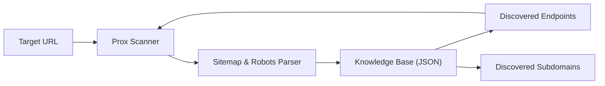

<div align="center">

```
  ██████╗ ██████╗  ██████╗ ██╗  ██╗███████╗ ██████╗ ██████╗ ██████╗ ███████╗
  ██╔══██╗██╔══██╗██╔═══██╗╚██╗██╔╝██╔════╝██╔════╝██╔═══██╗██╔══██╗██╔════╝
  ██████╔╝██████╔╝██║   ██║ ╚███╔╝ ███████╗██║     ██║   ██║██████╔╝█████╗  
  ██╔═══╝ ██╔══██╗██║   ██║ ██╔██╗ ╚════██║██║     ██║   ██║██╔═══╝ ██╔══╝  
  ██║     ██║  ██║╚██████╔╝██╔╝ ██╗███████║╚██████╗╚██████╔╝██║     ███████╗
  ╚═╝     ╚═╝  ╚═╝ ╚═════╝╚═╝  ╚═╝╚══════╝ ╚═════╝ ╚═════╝ ╚═╝     ╚══════╝
```

### ⚡ PROXSCOPE — Adaptive Web Security Scanner & Recon Suite v2.0

[](https://python.org)
[](LICENSE)
[]()
[]()
[]()

*An intelligent, multi-threaded web application security scanner and reconnaissance framework featuring an adaptive asset discovery engine, low false-positive heuristics, and calibrated 1-to-5 star vulnerability ratings.*

[Features](#-key-features) • [Installation](#-installation) • [Usage](#-usage-examples) • [Modules](#-audit-modules-16-total) • [Reporting](#-multi-format-reporting) • [License](#-license)

</div>

---

## 🚀 Key Features

- 🧠 **Adaptive Self-Learning Engine:** Automatically parses sitemaps, robots.txt, and link graphs during audits. Newly discovered endpoints, parameters, and subdomains are indexed in a persistent knowledge base (`knowledge/learned_assets.json`) and tested on subsequent runs.
- 🛡️ **16 Specialized Audit Modules:** Covers everything from DNS/email spoofing and open ports to CORS misconfigurations, credential leaks, and WAF fingerprinting.
- 📉 **Low False-Positive Heuristics:** Employs baseline differential response analysis and anti-bot/WAF challenge filtering to prevent generic scripts or error pages from generating false alerts.
- ⚡ **High-Speed Concurrency:** Powered by `concurrent.futures.ThreadPoolExecutor` for parallel socket probes and HTTP requests, reducing 5-minute audits down to sub-10-second executions.
- ⭐ **Calibrated Star Rating System:** Findings are categorized from ★☆☆☆☆ (Info) up to ★★★★★ (Critical) with a smooth asymptotic 10-point overall security score.
- 📄 **Multi-Format Export:** Export audits into responsive dark-mode HTML dashboards, structured JSON, or Markdown reports (`report.md`) ready for GitHub issues.
- 🤖 **AI-Generated Site Optimization:** Specifically tuned to detect common pitfalls in AI-generated web stacks (exposed `.env` files, leaked frontend API tokens, missing security headers, and permissive CORS).

---

## 📦 Installation

```bash
# Clone the repository
git clone https://github.com/prox0959/proxscope.git
cd proxscope

# Install dependencies
pip install -r requirements.txt
```

---

## 🔧 Usage Examples

```bash
# Basic quick audit
python prox.py https://example.com

# Audit and export responsive dark-mode HTML report
python prox.py https://example.com --output report.html

# Audit and export structured JSON data
python prox.py https://example.com --output report.json

# Audit and export Markdown summary
python prox.py https://example.com --output report.md

# Fast audit with 5-second timeout
python prox.py https://example.com -t 5

# Disable automatic knowledge learning
python prox.py https://example.com --no-learn
```

### CLI Arguments

| Flag | Name | Description | Default |
|------|------|-------------|---------|
| `target` | Positional | The target URL to audit (e.g. `https://example.com`) | Required |
| `-t`, `--timeout` | Optional | HTTP connection timeout in seconds | `8` |
| `-o`, `--output` | Optional | Export findings to file (`.html`, `.json`, or `.md`) | `None` |
| `--no-learn` | Optional | Disable automatic asset discovery & knowledge persistence | `False` |

---

## 📋 Audit Modules (16 Total)

| # | Module | Category | Description |
|---|--------|----------|-------------|
| 1 | 🛡️ **WAF Detection** | Recon | Detects Cloudflare, AWS WAF, Akamai, Imperva, ModSecurity, Sucuri |
| 2 | 🌐 **Subdomain Discovery** | OSINT | Passive enumeration of valid subdomains via Certificate Transparency (CT logs) |
| 3 | 🔌 **Port Scanner** | Network | Multi-threaded TCP socket scan of database and service ports (MySQL, SSH, RDP, Redis, Mongo) |
| 4 | 🛡️ **Security Headers** | Defensive | Audits CSP, HSTS, X-Frame-Options, X-Content-Type-Options, Permissions-Policy |
| 5 | 🔒 **SSL/TLS Security** | Cryptography | Verifies certificate validity, expiration, hostname matching, and HTTP-to-HTTPS redirect |
| 6 | 📧 **DNS & Email Security** | Recon | Queries SPF and DMARC records via DoH to identify spoofing and phishing vectors |
| 7 | 📂 **Sensitive Files** | Exposure | Concurrently scans for exposed `.env`, `.git/`, config backups, and database dumps |
| 8 | 🔎 **Tech Fingerprinting** | Recon | Identifies backend runtimes, frontend frameworks (Next.js, React, Vue), and CMS versions |
| 9 | 🍪 **Cookie Security** | Application | Audits `HttpOnly`, `Secure`, and `SameSite` flags on session cookies |
| 10 | 🌐 **CORS Configuration** | Application | Tests for wildcard origins (`*`), arbitrary origin reflection, and null origin bypass |
| 11 | 📡 **Info Disclosure** | Exposure | Scans for exposed debug dashboards (`/actuator`, `/debug`, `swagger`), stack traces, and comments |
| 12 | 🔑 **Source Code Analysis** | Static | Inspects HTML and bundled scripts for leaked AWS, Google, Stripe, and private keys |
| 13 | 💉 **XSS & SSTI Detection** | Injection | Canary-based reflected input testing and dynamic multi-digit template calculation |
| 14 | 🗄️ **SQL Injection** | Injection | Baseline-differential error-based and time-based database syntax checks |
| 15 | 📁 **Directory Listing** | Exposure | Identifies publicly indexable directories allowing file traversal |
| 16 | ↪️ **Open Redirect** | Application | Inspects redirect and callback parameters for arbitrary external destinations |

---

## ⭐ Star Rating & Scoring System

Findings are weighted according to severity and computed through an asymptotic risk decay curve:

| Rating | Severity | Description | Penalty |
|--------|----------|-------------|---------|
| ★★★★★ | **CRITICAL** | Direct code execution, SQLi, exposed `.env` credentials, private keys | `-2.0 pts` |
| ★★★★☆ | **HIGH** | Reflected XSS, permissive CORS with credentials, exposed admin ports, missing HSTS | `-1.5 pts` |
| ★★★☆☆ | **MEDIUM** | Missing CSP/clickjacking headers, missing SPF/DMARC, insecure session cookies | `-1.0 pts` |
| ★★☆☆☆ | **LOW** | Server version leaks, missing SameSite attributes, directory indexing | `-0.5 pts` |
| ★☆☆☆☆ | **INFO** | Technology stack discovery, open port inventory, RFC 9116 security.txt | `-0.1 pts` |

```
Security Score Formula: Score = 10.0 / (1.0 + (Total_Penalty / 6.0))
```

---

## 🧠 Adaptive Knowledge Engine

ProxScope contains an adaptive discovery engine that persists novel assets into `knowledge/learned_assets.json`:



- When auditing target `A`, any unique endpoints revealed in `sitemap.xml` or `robots.txt` are highlighted in bright green:
  ```
  ★ [LEARNED NEW ASSET] Discovered novel endpoint: /api/v2/auth (sitemap.xml)
  ```
- These discovered assets are saved and automatically incorporated into subsequent scans against future targets.

---

## 📸 Sample Terminal Output

```text
╔══════════════════════════ ⚡ PROX SECURITY AUDIT RESULTS ⚡ ══════════════════════════╗
║                                                                                       ║
║  ★★★★☆ HIGH (2 findings)                                                             ║
║    ┣━ Missing Strict-Transport-Security (HSTS) Header                                 ║
║       HSTS header is missing on HTTPS — connections can be downgraded to HTTP.        ║
║    ┗━ Zero Essential Security Headers Configured                                      ║
║       The website does not implement any foundational security headers.               ║
║                                                                                       ║
║  ★★★☆☆ MEDIUM (3 findings)                                                           ║
║    ┣━ Missing Content-Security-Policy Header                                          ║
║       CSP header is missing — no protection against Cross-Site Scripting (XSS).       ║
║    ┣━ Missing X-Frame-Options Header                                                  ║
║       X-Frame-Options is missing — website can be embedded in iframes.                ║
║    ┗━ Missing SPF (Sender Policy Framework) Record                                    ║
║       No SPF record found for domain. Attackers can forge emails from this host.      ║
║                                                                                       ║
║  ★☆☆☆☆ INFO (3 findings)                                                             ║
║    ┣━ WAF/CDN Protection Active: Cloudflare                                           ║
║       Front-facing Cloudflare Web Application Firewall detected.                      ║
║       ↳ Evidence: Header: cf-ray                                                      ║
║    ┗━ Discovered 8 active subdomains via CT logs                                      ║
║       ↳ Evidence: Hosts: api.example.com, dev.example.com, mail.example.com...        ║
║                                                                                       ║
║  ━━━━━━━━━━━━━━━━━━━━━━━━━━━━━━━━━━━━━━━━━━━━━━━━━━━━                                 ║
║    OVERALL SECURITY SCORE: 4.8/10 █████████░░░░░░░░░░░                                ║
║                                                                                       ║
║    🎯 Target:   https://example.com                                                   ║
║    ⏱  Duration: 6.2s                                                                  ║
║    📊 Total:    8 findings                                                            ║
║    📋 Breakdown: HIGH:2 | MEDIUM:3 | INFO:3                                           ║
║                                                                                       ║
╚═══════════════════════════════════════════════════════════════════════════════════════╝
✓ HTML report saved to: report.html
```

---

## 🏗️ Project Architecture

```
prox-multi-tool/
├── prox.py                    # Main CLI entry point
├── core/
│   ├── scanner.py             # Orchestrator & module runner
│   ├── learning.py            # Adaptive asset discovery engine
│   ├── reporter.py            # Calibrated scoring & HTML/JSON/MD exports
│   └── utils.py               # Shared data structures & banner
├── modules/
│   ├── waf_detect.py          # WAF & reverse proxy identification
│   ├── subdomain_finder.py    # CT-log passive subdomain discovery
│   ├── port_scan.py           # Multi-threaded TCP service & DB scanner
│   ├── header_scan.py         # Security response headers
│   ├── ssl_scan.py            # SSL/TLS certificate & redirect verification
│   ├── dns_security.py        # SPF & DMARC email spoofing audit
│   ├── sensitive_files.py     # Parallel sensitive file & credential scanner
│   ├── tech_detect.py         # Technology & runtime fingerprinting
│   ├── cookie_scan.py         # Cookie security flags
│   ├── cors_scan.py           # CORS misconfiguration audit
│   ├── info_disclosure.py     # Debug endpoint & stack trace leaks
│   ├── source_scan.py         # Static code credential & key leak analysis
│   ├── xss_scan.py            # Reflected XSS & SSTI detection
│   ├── sqli_scan.py           # Baseline-differential SQLi detection
│   ├── dir_listing.py         # Open directory index scanner
│   └── open_redirect.py       # Open URL redirect analysis
├── knowledge/                 # Persistent self-learning store
│   └── learned_assets.json
├── wordlists/                 # Sensitive paths, dirs, and test payloads
├── requirements.txt
├── LICENSE                    # MIT License
└── README.md
```

---

## ⚠️ Legal & Ethical Disclaimer

This software is developed strictly for **educational purposes**, **authorized security auditing**, and **defensive risk assessments**. Testing targets without prior written authorization from the system owner is illegal and unethical. The developer assumes no liability for misuse of this tool.

---

## 👤 Author

**[@prox0959](https://github.com/prox0959)**  
GitHub: [https://github.com/prox0959](https://github.com/prox0959)

---

## 📄 License

This project is open-source and released under the [MIT License](LICENSE).
